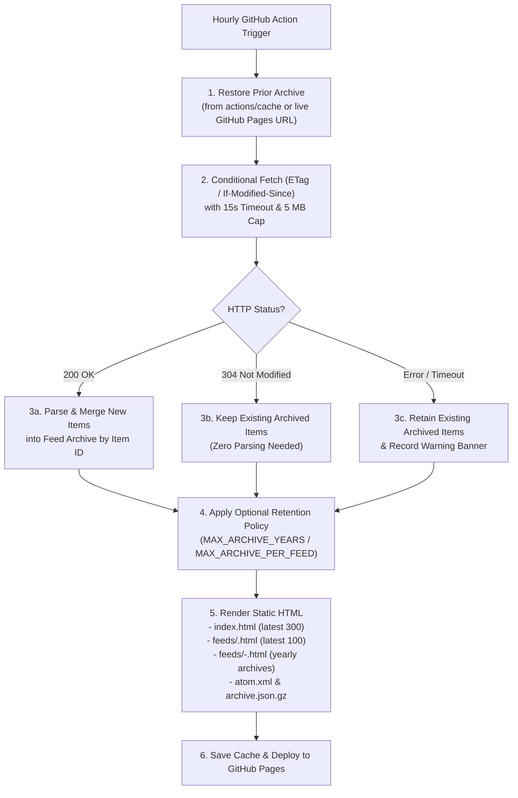

# RFD 0001: Progressive Feed Fetching and Year-Sharded Archival

- **RFD:** 0001
- **Title:** Progressive Feed Fetching and Year-Sharded Archival
- **Status:** Proposed
- **Created:** 2026-10-16
- **Related:** RFD 0002 (security hardening), RFD 0003 (CI test gating and workflow permissions), RFD 0004 (timeline bar)

---

## 1. Context & Problem Statement

Currently, `build.py` operates as a completely stateless build script:

1. Every hour, `.github/workflows/build.yml` runs `python build.py` on a fresh runner.
2. `build.py` deletes `site/` (`shutil.rmtree(OUT)`), fetches each feed in `feeds.txt`, slices at most `MAX_PER_FEED = 50` entries per feed, and deploys `site/` to GitHub Pages.

This stateless design introduces three core limitations:

1. **Permanent loss of rolled-off feed items:** RSS and Atom feeds are sliding windows (typically serving only the latest 10–50 items). Once a publisher posts enough new entries for an older entry to roll off their XML feed, `build.py` permanently drops that entry on the very next hourly build.
2. **Intolerance to transient upstream outages:** If an upstream blog or RSS server returns a `5xx` error or times out during an hourly run, that feed's page (`site/feeds/<slug>.html`) and all of its entries disappear from the generated site until the next successful build.
3. **Redundant bandwidth and parsing:** Every hourly run downloads and parses the full XML body of every feed from scratch, even when nothing has been published for weeks.

At the same time, preserving historical feed items indefinitely raises questions around **GitHub Pages storage limits**, **GitHub Actions free-tier quotas**, **Git repository bloat**, and **browser rendering performance** as item counts grow over multiple years.

---

## 2. Goals & Non-Goals

### Goals
- **Preserve historical items** even after they roll off the upstream RSS/Atom XML feed.
- **Survive transient feed outages** by retaining previously archived items when a feed fails to fetch.
- **Support progressive updates** using HTTP conditional requests (`ETag` and `Last-Modified` / `304 Not Modified`).
- **Avoid Git repository bloat** (no hourly automated commits to the Git repository).
- **Stay well within free GitHub Pages and GitHub Actions limits** across multi-year retention periods.
- **Keep HTML pages small and fast** on mobile and desktop browsers regardless of how many years of history are archived.

### Non-Goals
- Full-text article scraping or storing remote images/media attachments.
- Requiring an external database, server, or paid cloud storage service.

---

## 3. Quota & Scaling Analysis

### 3.1 GitHub Pages Storage Limits
- **Limit:** GitHub Pages enforces a **1 GB** published site size limit and a **10-minute** deployment timeout.
- **Per-item footprint:** Each normalized entry in `build.py` stores:
  - `id` / `link` (~100 bytes)
  - `title` (~80 bytes)
  - `date` (~25 bytes ISO-8601)
  - `summary` (capped at `SUMMARY_CHARS = 280` bytes)
  - `feed` (~40 bytes)
  - Total: **~550 bytes per entry** (uncompressed JSON/HTML) or **~150 bytes per entry** (gzip-compressed).
- **Multi-year projection:**
  | Scale | Total Entries | Raw Size | Gzipped Archive Size | % of 1 GB Pages Limit |
  |---|---:|---:|---:|---:|
  | 25 feeds × 200 posts/yr × 5 yrs | 25,000 | ~14 MB | ~3.8 MB | **1.4%** |
  | 100 feeds × 300 posts/yr × 5 yrs | 150,000 | ~82 MB | ~22.5 MB | **8.2%** |
  | 200 feeds × 500 posts/yr × 10 yrs | 1,000,000 | ~550 MB | ~150 MB | **55.0%** |

**Conclusion:** Storing plain-text metadata and 280-character summaries will not threaten the 1 GB GitHub Pages limit for decades of normal use.

### 3.2 Browser DOM Size Limits (Why HTML Sharding Is Required)
While total site storage is small, rendering 10,000+ `<article>` nodes into a single `feeds/<slug>.html` file produces a multi-megabyte HTML document that causes sluggish layout and high memory usage on mobile browsers. Therefore, **individual HTML pages must remain bounded** via year-based sharding (`feeds/<slug>-2026.html`, `feeds/<slug>-2025.html`, etc.).

### 3.3 GitHub Actions Free-Tier Limits
- **Public repositories:** GitHub Actions minutes are **unlimited and free** for standard GitHub-hosted runners (`ubuntu-latest`), and GitHub Pages is free.
- **Private repositories:** Free-tier accounts include **2,000 minutes/month** (note: GitHub Pages on private repos requires GitHub Pro). An hourly cron runs ~720 times/month × ~1 billable minute = ~720 minutes/month.
- **GitHub Actions Cache limit:** 10 GB per repository (entries evicted after 7 days of no access; hourly builds access the cache every hour so it stays warm).

---

## 4. Proposed Architecture



### 4.1 State Persistence Without Git Repository Bloat

#### Why Not Commit `archive.json` to Git Every Hour?
Committing an updated archive file to the `main` branch every hour generates **8,760 commits per year**. Because Git stores snapshots of modified blobs, repeatedly modifying a multi-megabyte JSON file causes the `.git/objects/pack` directory to grow into hundreds of megabytes or gigabytes, slowing down `actions/checkout` and local clones.

#### Dual-Layer Stateless-Git Storage (`site/archive.json.gz`)
Instead of committing state to Git, the build persists a compressed state file (`archive.json.gz`) using two complementary mechanisms:

1. **Primary (Fast Local Restore): `actions/cache`**
   - After `build.py` finishes, the workflow caches `.cache/archive.json.gz` keyed by `archive-v1-${{ github.run_id }}` with `restore-keys: archive-v1-`.
2. **Secondary (Self-Healing Durable Fallback): Live GitHub Pages Artifact**
   - `build.py` also copies `archive.json.gz` into `site/archive.json.gz` so it is deployed directly to `https://<user>.github.io/<repo>/archive.json.gz`.
   - If the GitHub Actions cache is ever cleared or evicted (e.g., if the workflow was paused for >7 days), `build.py` automatically downloads `https://<user>.github.io/<repo>/archive.json.gz` at startup to seed the state before fetching feeds.

This guarantees durability without a single automated Git commit.

---

### 4.2 Archive Data Schema (`archive.json.gz`)

```json
{
  "version": 1,
  "updated_at": "2026-10-16T01:00:00+00:00",
  "feeds": {
    "https://maggieappleton.com/rss.xml": {
      "url": "https://maggieappleton.com/rss.xml",
      "title": "Maggie Hugo",
      "site": "https://maggieappleton.com",
      "etag": "\"652f1a-4b21\"",
      "last_modified": "Wed, 15 Oct 2026 18:20:00 GMT",
      "last_success": "2026-10-16T01:00:00+00:00",
      "items": {
        "https://maggieappleton.com/post-1": {
          "id": "https://maggieappleton.com/post-1",
          "title": "Example Post Title",
          "link": "https://maggieappleton.com/post-1",
          "date": "2026-10-14T12:00:00+00:00",
          "first_seen": "2026-10-14T12:17:00+00:00",
          "summary": "Plain-text truncated summary..."
        }
      }
    }
  }
}
```

#### Item Identity & Deduplication Rules
1. **Feed-Namespaced Stable Item Key (`item_id`):**
   Use the same feed-namespaced SHA-1 `entry_id()` function introduced in RFD 0002 (§4.6, §9), computed from the feed URL plus the entry's own `id`, `link`, or `title`/`date`/`summary`. Namespacing by feed URL prevents a hostile feed from colliding with or overwriting another feed's entries.
2. **Timestamp Preservation (`first_seen`):**
   - If an upstream feed omits `<pubDate>`/`<updated>`, `build.py` records `first_seen` on the first build that discovers the item and reuses `first_seen` on subsequent builds so undated items do not jump to the top of the front page every hour.
3. **Merge Semantics:**
   - When an upstream feed is fetched, its current entries are upserted into `feeds[url]["items"][item_id]`.
   - Any existing `item_id` in `feeds[url]["items"]` that is no longer present in the live XML feed **is preserved untouched**.
   - If a feed is removed from `feeds.txt`, it is omitted from rendered pages (and optionally pruned from `archive.json.gz` or kept inactive).

---

### 4.3 Progressive Conditional Fetching & Fault Tolerance

For each feed in `feeds.txt`:
1. Look up prior `etag` and `last_modified` values from `archive["feeds"].get(url)`.
2. Extend RFD 0002's `download()` function (rather than introducing a second fetcher) to accept optional `etag` and `last_modified` headers:
   - `If-None-Match: <etag>` (if present)
   - `If-Modified-Since: <last_modified>` (if present)
   - Enforces RFD 0002's pinned public-IP checks, `FETCH_TIMEOUT` (20 s), `MAX_REDIRECTS` (5), and `MAX_FEED_BYTES` (5 MiB) before and after gzip/deflate decompression.
3. Handle the response:
   - **`304 Not Modified`:** Skip XML parsing completely; keep all existing items in `archive["feeds"][url]["items"]` and update `last_success`.
   - **`200 OK`:** Parse the feed via `parse_isolated()` (`io.BytesIO(data)` inside the time- and memory-bounded child process from RFD 0002 §4.3), merge new/updated entries into `archive["feeds"][url]["items"]`, and save the new `ETag` and `Last-Modified` response headers.
   - **Network/HTTP/Parse Error:** Keep all previously archived items in `archive["feeds"][url]["items"]` so the feed's pages stay online, and record the `clean()`-sanitized error message (along with `last_success`) in the status banner.

---

### 4.4 Year-Sharded Static HTML & Configurable Retention Caps

To keep every HTML file fast to load while preserving multi-year history:

1. **Front Page (`site/index.html`):**
   - Renders the newest `MAX_ITEMS = 300` entries across all active feeds.
2. **Feed Landing Page (`site/feeds/<slug>.html`):**
   - Renders the newest `MAX_PER_FEED_PAGE = 100` entries for that feed.
   - Displays a year navigation bar at the top and bottom of the feed page when entries span multiple years or exceed `MAX_PER_FEED_PAGE`:
     ```html
     <nav class="years">
       <a href="maggie-hugo.html" class="on">Recent (100)</a>
       <a href="maggie-hugo-2026.html">2026 (42)</a>
       <a href="maggie-hugo-2025.html">2025 (38)</a>
       <a href="maggie-hugo-2024.html">2024 (29)</a>
     </nav>
     ```
3. **Feed Year Archive Pages (`site/feeds/<slug>-<year>.html`):**
   - Renders all archived entries for that feed published in `<year>` (or `"undated"` if no timestamp exists).
   - Because completed calendar years are immutable once items roll off the live feed, older year pages remain static and bounded in size.
4. **Configurable Retention Safety Caps (Optional):**
   Add two constants in `build.py` so users can choose between unlimited archival or bounded retention:
   ```python
   MAX_ARCHIVE_YEARS: int | None = None      # e.g. 5 to keep only the last 5 years, or None for unlimited
   MAX_ARCHIVE_PER_FEED: int | None = 5000   # safety cap per feed to guard against runaway feeds
   ```

---

## 5. GitHub Workflow Integration (`.github/workflows/build.yml`)

Following RFD 0003 (§3.4, §9), the `actions/cache` step is pinned to a full commit SHA and placed **only in the `build` job** (never in `test`, so tests stay deterministic and PRs cannot read or write archive caches):

```yaml
      - name: Restore feed archive cache
        uses: actions/cache@<full-commit-sha> # v4.x.x
        with:
          path: .cache
          key: feed-archive-${{ github.run_id }}
          restore-keys: |
            feed-archive-

      - name: Build static site
        env:
          ARCHIVE_CACHE_PATH: .cache/archive.json.gz
          ARCHIVE_FALLBACK_URL: https://${{ github.repository_owner }}.github.io/${{ github.event.repository.name }}/archive.json.gz
        run: python build.py
```

---

## 6. Relationships to Other RFDs

- **RFD 0002 (Security Hardening):**
  - Conditional fetching extends `download()`, and fallback bootstrapping of `archive.json.gz` from the live Pages URL also goes through `download()` and bounded `decode_body()` (with a dedicated `MAX_ARCHIVE_BYTES` limit).
  - Restored archive entries are treated as untrusted input: links pass through `sanitize_link()` again at render time, and text fields are HTML/XML-escaped.
- **RFD 0003 (Test-Gated Deploys & Least Privilege):**
  - `actions/cache` is SHA-pinned and scoped strictly to the `build` job. Offline unit tests in `tests/` test archive merging, `304 Not Modified` handling, and year-shard rendering using local fixtures without network access.
- **RFD 0004 (Interactive Year-Range Timeline Scrub Bar):**
  - Each feed's full archived year span (`min_year` to `max_year`) and `<article data-year="YYYY">` attributes power RFD 0004's upper-right timeline bar, and `site/feeds/<slug>-<year>.html` shards allow RFD 0004 to filter or lazy-load historical years on demand.

---

## 7. Implementation Plan

1. **Phase 1 — Archive Store & Conditional HTTP Fetcher (`build.py`):**
   - Implement `load_archive()` (reading from `ARCHIVE_CACHE_PATH` with fallback to `ARCHIVE_FALLBACK_URL` via `download()` and bounded decompression) and `save_archive()` (writing both `ARCHIVE_CACHE_PATH` and `site/archive.json.gz`).
   - Extend RFD 0002's `download()` to send `If-None-Match` / `If-Modified-Since` and handle `304 Not Modified`.
2. **Phase 2 — Item Merging & Retention Policy (`build.py`):**
   - Merge newly fetched entries with archived entries keyed by RFD 0002's feed-namespaced `entry_id()`, preserving `first_seen` dates and retaining rolled-off entries.
   - Apply `MAX_ARCHIVE_YEARS` and `MAX_ARCHIVE_PER_FEED` pruning if configured.
3. **Phase 3 — Year-Sharded Rendering (`build.py`):**
   - Generate `site/feeds/<slug>-<year>.html` pages and add the year archive navigation bar to per-feed pages.
4. **Phase 4 — Workflow Caching (`.github/workflows/build.yml`):**
   - Add the SHA-pinned `actions/cache` step in `build` and pass `ARCHIVE_CACHE_PATH` and `ARCHIVE_FALLBACK_URL` environment variables to `python build.py`.
