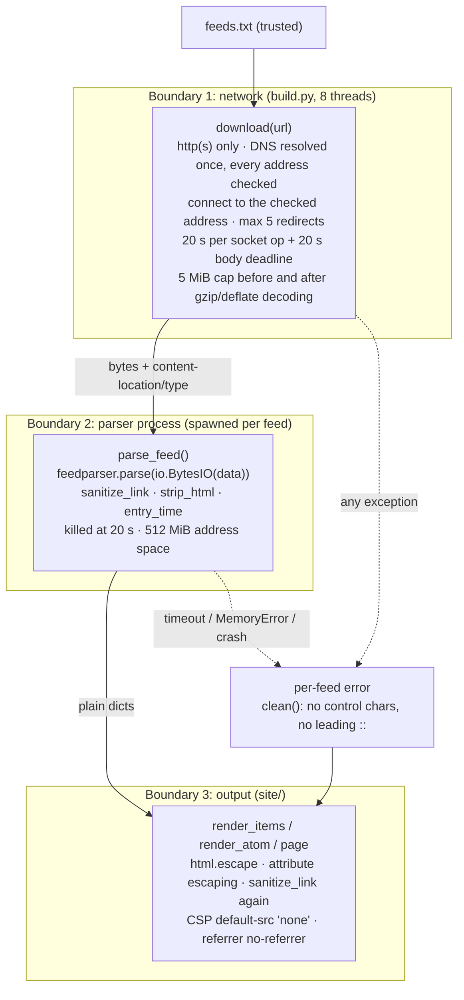

# RFD 0002: Hardening Feed Fetching, Parsing and Rendering

- **RFD:** 0002
- **Title:** Hardening Feed Fetching, Parsing and Rendering
- **Status:** Implemented on branch `security-hardening`, pending review
- **Created:** 2026-10-16
- **Related:** RFD 0003 (workflow changes), RFD 0001 (feed archival), RFD 0004 (timeline bar), `docs/security-review.md`, `docs/security-review-validation.md`, `docs/dependency-review.md`

---

## 1. Context & Problem Statement

`build.py` downloads every feed in `feeds.txt`, parses it with feedparser, and renders a static site to GitHub Pages every hour. A feed's content is written by whoever controls the feed's server. That might be a blog we trust today, but domains expire, hosts get compromised, and any server can redirect anywhere.

Three reviews of the code found that one hostile feed could do the following:

1. **Run JavaScript on the published site.** A `javascript:` or `data:` article link was copied straight into an `href`. GitHub Pages serves all of a user's project sites from one origin (`https://<user>.github.io`), so script running here could also read the storage of the user's other Pages projects.
2. **Read internal services or local files from the build machine.** Redirects to `127.0.0.1` and private addresses were followed, and what came back was published. Passing raw bytes to `feedparser.parse()`, as the first review proposed, would also have made feedparser open those bytes as a local file path.
3. **Stop the site updating.** It could do this in any of these ways:
    - hold a connection open with no timeout;
    - send an unbounded or gzip-bombed body;
    - trigger super-linear regexes in our code and in feedparser;
    - expand one internal XML entity into hundreds of megabytes;
    - send a date that makes `datetime` raise outside the per-feed error handling.
4. **Corrupt `atom.xml` or the build log.** Quotes weren't escaped in Atom attributes, and newlines in error text could inject GitHub Actions log commands.

Most of these were confirmed with working reproducers. The before-and-after results are in §7.

### Threat model

- **Attacker:** anyone who controls the response to a URL in `feeds.txt`, or anything that URL redirects to. That covers the body, headers, status code and redirects.
- **Assets:**
    - visitors to the Pages origin;
    - the build runner's network position and local files;
    - the site's availability, meaning the hourly update keeps happening.
- **Trusted:** `feeds.txt` and the repository itself. Anyone who can edit them can already change `build.py`.

---

## 2. Goals & Non-Goals

### Goals
- No feed can make the published site run script, or send visitors' data elsewhere beyond the article link they click.
- No feed can make the build connect to loopback, private, link-local or other non-public addresses, or read local files.
- One feed's failure, however it fails, affects only that feed. The rest of the site still builds, within a bounded time.
- Errors shown on the site and in the log can't carry markup or workflow commands.
- Behaviour is covered by tests that need no network, so they run on every PR (RFD 0003).

### Non-Goals
- **Checking that feed content is true or authentic.** A compromised feed can still publish misleading titles and links.
- **Rendering feed HTML.** Summaries stay plain text.
- **Defending against changes to `feeds.txt` or the code.** That is a repository-access question.
- **Running on Windows or macOS with the same guarantees.** The parser memory cap is Linux-only (§4.3).

---

## 3. Findings Addressed

| Ref | Issue | Severity (our context) | Fix |
| --- | --- | --- | --- |
| §2.1 | `javascript:` / `data:` links become an `href` (stored XSS) | High | `sanitize_link()` at extraction and at render time; CSP |
| §2.3 | No Content Security Policy | Defence in depth | CSP `<meta>` on every page |
| §2.2 | `"` not escaped in `atom.xml` attributes | Medium | Attribute escaping |
| §3.1 | No timeout, unbounded body, gzip bomb | Medium | `download()` |
| §3.2 | Quadratic regex in `strip_html()` | Medium | `HTMLParser`-based stripper |
| §3.3 | Redirects followed to loopback and private IPs | Medium | Pinned, checked connections |
| New | `feedparser.parse(bytes)` opens the bytes as a file path | High (in the proposed fix) | Pass `io.BytesIO` |
| Dep F3/F4 | feedparser regexes are cubic or quadratic and hold the GIL | High | Parse in a child process with a time limit |
| Dep F5 | feedparser's fallback parser expands entities without limit | High | Memory cap on that process |
| Dep F6 | Year-0 or year-10000 dates abort the whole build | Medium | `entry_time()` skips them |
| §3.4.4 | Workflow commands injected through log lines | Low | `clean()` |
| §1 | Referer sent on article clicks | Low | `no-referrer` policy |
| §3 / F11 | External entities (XXE) | None today | Regression tests only (§5.8) |

Section numbers refer to `docs/security-review.md`. "Dep" findings are from `docs/dependency-review.md`.

---

## 4. Design

Untrusted bytes cross three boundaries, and each one has its own controls:

### 4.1 Links (§2.1)

`sanitize_link(url, fallback)` returns `url` only if `urllib.parse.urlsplit()` gives an `http` or `https` scheme and a hostname. Otherwise it tries `fallback` the same way, and if that fails too it returns `"#"`. `urlsplit` strips tab, CR and LF characters, so `jav\tascript:` is caught as `javascript:`.

- **Where it runs:**
    - The channel link falls back to the feed URL, which `download()` has already required to be http(s).
    - Each item link falls back to the channel link.
    - It runs again in `render_items()` and `render_atom()`, so an item that reaches the renderers some other way (for example RFD 0001's archive) is still checked.
- **Why not rely on feedparser:** feedparser has a scheme filter (`make_safe_absolute_uri`), but its `link` handling never calls it (`mixin.py:449-450`). We don't depend on upstream for this.

### 4.2 Network (§3.1, §3.3)

`download()` replaces `feedparser.parse(url)`. It builds its own `OpenerDirector` with only HTTP, HTTPS, redirect and error handlers. With no file, ftp, data or proxy handlers, a non-http(s) URL or redirect has nothing to open.

- **Connection checks:** `PinnedHTTPConnection.connect()` resolves the host once. If any resolved address is not global (`ipaddress.is_global`, plus multicast), it refuses. Otherwise it connects to one of those checked addresses.
    - Checking and connecting use the same DNS answer, so DNS rebinding can't slip past.
    - The check runs on every connection, which covers the initial URL and every redirect hop.
    - IPv4-mapped and 6to4 IPv6 addresses are unwrapped and checked as IPv4.
    - TLS still verifies the hostname (`server_hostname=self.host`).
- **Redirects:** `SafeRedirectHandler` allows at most 5, and only to http(s).
- **Limits:** a 20 s socket timeout per operation, plus a 20 s deadline for reading the body. The body is read in chunks and refused past 5 MiB.
- **Compression:** `download()` sends `Accept-Encoding: gzip, deflate`. `decode_body()` decompresses with `zlib.decompressobj` and a maximum output length, so a decompression bomb is refused after at most 5 MiB of output instead of being expanded in full.
    - It handles `x-gzip`, multi-member gzip, and raw deflate sent as `deflate`.
    - Any other encoding, or a truncated or corrupt stream, becomes that feed's error.
    - A 200 MiB gzip bomb (about 200 KB on the wire) is refused in under 2 s.
- **Passing the body to feedparser:** as `io.BytesIO(data)`, never raw bytes, because feedparser treats a bytes argument as a file path first (`api.py:118`). We also pass `response_headers` with `content-location` (the final URL), so relative links still resolve, and `content-type`, so the charset is honoured.
- **No escape hatch:** the address check can't be turned off. `ALLOW_PRIVATE` is a module flag that only the tests patch, to reach their own loopback server; environment variables don't affect it. A feed served from your own machine or LAN can't be read.

### 4.3 Parsing in a child process (Dep F3, F4, F5)

`parse_isolated()` runs `parse_feed()`, which does feedparser plus item extraction, in a process started with `multiprocessing`'s `spawn` method.

- **The child:**
    - sets `RLIMIT_AS` to 512 MiB (`PARSE_MEMORY`) before parsing;
    - sends back plain dicts, or an error string.
- **The parent:**
    - waits up to 20 s (`PARSE_TIMEOUT`) for the result;
    - then kills the child and reaps it.
- **What a failure becomes:** a timeout, `MemoryError` or child crash becomes that feed's error, and the other feeds build as normal.
- **Feed bytes go over the result pipe, not as process arguments.** CPython keeps the child's end of the spawn pipe open until it finishes writing the start-up data. A payload over 64 KB therefore blocks the parent forever if the child dies before reading it. This hang was reproduced during development; sending the bytes over the result pipe turns it into a `BrokenPipeError`.

Alternatives considered:

| Option | Why not |
| --- | --- |
| Thread timeout | feedparser's regexes hold the GIL. During one slow parse, another thread dropped from 46M to 73k iterations/s, and a thread can't be killed anyway. |
| `ProcessPoolExecutor` with `result(timeout=)` | The timeout returns control to the caller, but the stuck worker keeps running. |
| `fork` start method | The parent is multi-threaded, and forking a threaded process is unsafe (Python 3.12 warns about it). |
| Reject bodies containing `<!ENTITY` or repeated `encoding=` | Blocks the known inputs only. The quadratic paths in `sanitizer.py`, `mixin.py` and `strict.py` would still reach hours at the 5 MiB cap. |
| Lower `MAX_FEED_BYTES` | Turns hours into minutes; doesn't bound anything. |

`RLIMIT_AS` only exists on Linux. On other platforms the child runs without a memory cap, but the time limit still applies.

### 4.4 Text extraction (§3.2)

`strip_html()` uses an `html.parser.HTMLParser` subclass in place of the old `(?is)<(script|style).*?</\1>` regex.

- **Output:**
    - tags and comments become spaces;
    - `<script>` and `<style>` bodies are dropped, including unclosed ones;
    - character references are decoded;
    - runs of whitespace collapse to one space.
- **Speed:** 200,000 unclosed `<script>` tags take 0.004 s, against 7.2 s for 20,000 tags with the regex.
- **Behaviour change:** literal `<` … `>` in plain text is now kept. For example, "a < b and c > d" used to collapse to "a d".

### 4.5 Dates (Dep F6)

`entry_time()` catches `ValueError`, `OverflowError` and `OSError` from `datetime.fromtimestamp()`, then tries the next date field. feedparser's ISO-8601 fallback can return year 0 or 10000, for example from `0000-01-01T00:00:00Z`. An item with no usable date is shown as undated.

### 4.6 Output (§2.2, §2.3, Referer)

- **Every page's `<head>`:**
    - `<meta http-equiv="Content-Security-Policy" content="default-src 'none'; style-src 'unsafe-inline'; base-uri 'none'; form-action 'none'">`. GitHub Pages can't set response headers, so a `<meta>` tag is the only option. This blocks scripts, including `javascript:` navigation, even if an escaping bug comes back. The pages need only their inline `<style>`.
    - `<meta name="referrer" content="no-referrer">`. Article links also get `rel="noopener noreferrer"`. Browsers already sent only the origin, so the gain is small.
- **`atom.xml`:** attribute values escape `"` as `&quot;`, and the file parses with `xml.etree`.
- **Atom ids:** each entry's `<id>` is computed by `entry_id()` and namespaced by the feed's URL. Before, entries whose link fell back to the same URL shared an id. Namespacing also stops a hostile feed from reusing another feed's entry ids, which some readers use to replace the trusted feed's entries.

### 4.7 Errors and logs (§3.4.4)

`clean()` turns C0 and C1 control characters, DEL, and U+2028/U+2029 into spaces, then strips leading `:` and spaces. It runs on:

- every fetch and parse error when the error is created;
- the URL and the error in the stderr line;
- the URL and the error in the HTML error list, which is still truncated to 200 characters.

Each error therefore stays on one line, and a line can't start with `::`, which GitHub Actions would read as a workflow command.

### 4.8 External entities (§3 / Dep F11)

No code change was needed. Two layers stop external entities today, and both are upstream:

1. Expat runs with external general entities disabled. In CPython this one setting also covers external DTDs and parameter entities.
2. feedparser's `replace_doctype()` removes external declarations, but only when they start a line.

Forcing expat's setting on made the one-line forms leak local file contents. Because the protection relies on one upstream setting, `ExternalEntityTest` now covers all six forms and fails if that setting changes. Details are in `docs/security-review-validation.md`.

---

## 5. Constants

| Name | Value | Purpose |
| --- | --- | --- |
| `FETCH_TIMEOUT` | 20 s | Per socket operation, and the body-read deadline |
| `MAX_FEED_BYTES` | 5 MiB | Largest body accepted |
| `MAX_REDIRECTS` | 5 | Redirect hops per feed |
| `PARSE_TIMEOUT` | 20 s | Wall-clock limit for parsing one feed |
| `PARSE_MEMORY` | 512 MiB | Address-space cap for the parser process (Linux) |
| `ALLOW_PRIVATE` | `False` | Turns off the non-public address check. Tests only; not configurable. |

---

## 6. Behaviour Changes

- **Proxies are ignored.** `HTTP(S)_PROXY` no longer applies to feed fetches.
- **HTTP 4xx/5xx responses become feed errors** (for example "HTTP Error 404") instead of being parsed.
- **Only gzip and deflate are accepted.** A response in any other `Content-Encoding`, such as `br`, becomes that feed's error.
- **Private-address feeds can't be read at all.** There is no escape hatch.
- **Every `atom.xml` entry id changes once.** Ids are now `urn:sha1:` of the feed URL plus the entry's own id, link, or title/date/summary (§4.6). Existing subscribers will see each entry once more after the first deploy.
- **Each feed costs about 0.2 s more**, to start its parser process. This runs in parallel across the 8 fetch threads.
- **A hostile feed costs up to 20 s per build** before it is killed, plus up to 20 s of download time.
- **`strip_html()` keeps literal `<` … `>` text** (§4.4).
- **Unsafe links fall back** to the channel link, then the feed URL, and never to `"#"` for fetched items.

---

## 7. Verification

50 standard-library tests in `tests/` need no network. All of them passed with every DNS lookup and connection to anything except loopback made to fail. They pass on Python 3.12.15 and on 3.13.13 with the hash-pinned install.

- `tests/test_render.py` (9): link sanitizing, Atom escaping, CSP and referrer, `strip_html` speed and output.
- `tests/test_fetch.py` (27): limits, decompression, SSRF, redirects, schemes, relative links, charset, `clean()`, no environment escape hatch.
- `tests/test_parse.py` (14): dates, parser-process timeout and memory cap, external entities, Atom ids.

The same malicious feeds were replayed before (`0600b1e`) and after, through the real `fetch()` and renderers:

| Attack | Before | After |
| --- | --- | --- |
| `<link>javascript:alert(document.domain)</link>` | `href="javascript:…"` emitted | channel link used |
| Link containing `"` in `atom.xml` | `<link href="…a" onx="1"/>` | `&quot;`; XML parses |
| 20,000 unclosed `<script>` in a title | 7.21 s | 0.05 s |
| 302 redirect to `http://127.0.0.1/internal` | followed; internal title published | refused |
| Server that never responds | waits until the 6 h job limit | timed out |
| 6 MiB body / 200 MiB gzip bomb | read or decompressed in memory | refused / refused after 5 MiB of output, in under 2 s |
| 68 KB feed with one entity referenced 6,000 times | 887 MiB peak memory | `MemoryError` in 0.1 s |
| 26 KB XML declaration with repeated `encoding=` | 21 s, all threads stalled | killed at 20 s |
| Item dated `0000-01-01T00:00:00Z` | whole build aborts | item builds, undated |
| Four hostile feeds plus one normal feed | build hangs or crashes | normal feed builds; 20.1 s total |

---

## 8. Residual Risks & Future Work

- **Slow headers:** a server that drips response headers is bounded only by the per-operation timeout and `http.client`'s header limits. The job's `timeout-minutes` is the backstop.
- **Connect timeouts add up:** connecting can take up to 20 s for each resolved address.
- **Some IPv6 forms aren't unwrapped:** NAT64 (`64:ff9b::/96`) and Teredo addresses that embed private IPv4. This only matters on NAT64 networks.
- **Unreported upstream bugs:** F3 (cubic XML-declaration regex) and F5 (unbounded entity expansion) aren't in feedparser's tracker. They should be reported to the maintainer privately.
- **XXE depends on one upstream setting**, now covered by tests (§4.8).

---

## 9. Relationship to RFD 0001 and RFD 0004

RFD 0001 proposes conditional fetching and a persistent archive. If it is implemented, it should build on this RFD:

- **Fetching:** extend `download()` with `If-None-Match` / `If-Modified-Since` and `304` handling. Don't add a second fetcher; RFD 0001's Phase 1 bounded fetcher is `download()`.
- **Archive bootstrap:** the archive download from the Pages URL should go through `download()`. If the archive file itself is gzipped (rather than served with `Content-Encoding`), decode it with `decode_body()` or the same bounded approach. Its size will also outgrow `MAX_FEED_BYTES` and need its own limit.
- **Item identity:** RFD 0001's `item_id` should be namespaced by feed URL the same way as `entry_id()` (§4.6), for the same reason.
- **Archived items are untrusted input:** they come from feeds. Links must go through `sanitize_link()` again at render time, which `render_items()` and `render_atom()` already do. Titles and summaries must stay plain text and be escaped.
- **Parsing:** merging and parsing should stay inside the parser process so the time and memory limits still apply.

RFD 0004 proposes an interactive year-range timeline bar in the page header:

- **Content Security Policy:** RFD 0004's inline script should be authorized via a build-time `'sha256-...'` hash in `script-src` (rather than `'unsafe-inline'`), so `javascript:` URIs, event-handler attributes, and any injected `<script>` tags remain blocked by the CSP. If RFD 0004 lazy-loads year shard pages from RFD 0001, `connect-src 'self'` is added alongside `default-src 'none'`.
- **DOM handling:** the timeline script must only read integer `data-year` attributes and update `.hidden`, CSS offsets, and `.textContent`, never `innerHTML` or untrusted feed fields.

---

## 10. Implementation

On branch `security-hardening`, based on `e3bd541`:

| Commit | Change |
| --- | --- |
| `adf3d70` | Sanitize article links; escape quotes in `atom.xml` attributes |
| `d6a7d1c` | CSP and `no-referrer` meta tags |
| `2def64d` | Linear-time `HTMLParser` stripper |
| `ff639f8` | Bounded downloads: timeout, deadline, 5 MiB cap, `io.BytesIO` |
| `8e21fe7` | Refuse non-http(s) and non-public addresses; pinned connections |
| `c5da59b` | Clean URLs and errors in logs and the error list |
| `ed2b976` | Fall back to the feed URL when item and channel links are both unsafe |
| `7cde9f8` | Skip out-of-range entry dates |
| `8213006` | Parse each feed in a child process with time and memory limits |
| `fab9f69` | External-entity regression tests |
| `1ee96a1` | Remove the `RSS_ALLOW_PRIVATE` escape hatch |
| `1d5d5f1` | Bounded gzip/deflate decoding |
| `b97b7c9` | Unique, feed-namespaced Atom ids |
