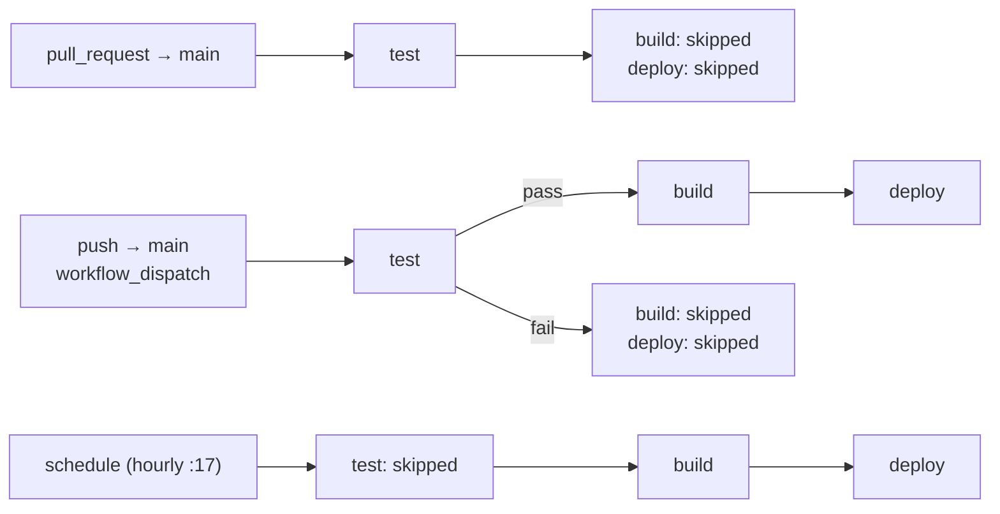

# RFD 0003: Test-Gated Deploys and a Least-Privilege Build Workflow

- **RFD:** 0003
- **Title:** Test-Gated Deploys and a Least-Privilege Build Workflow
- **Status:** Implemented on branch `security-hardening`, pending review. Not yet run on GitHub.
- **Created:** 2026-10-16
- **Related:** RFD 0002 (security hardening), RFD 0001 (feed archival), RFD 0004 (timeline bar), `docs/security-review.md` §3.4

---

## 1. Context & Problem Statement

`.github/workflows/build.yml` builds the site and deploys it to GitHub Pages hourly, on every push to `main`, and on manual runs. Before this change it had these weaknesses:

1. **No tests ran anywhere.** A push to `main` deployed whatever it contained, and pull requests weren't checked at all.
2. **Too many permissions.** `pages: write` and `id-token: write` were granted to the whole workflow. That includes the `build` job, which installs third-party packages and parses untrusted remote feeds.
3. **Nothing was pinned.** `feedparser>=6.0` floated, so every run re-resolved it. Actions were referenced by tags such as `@v5`, which can be moved.
4. **No job timeouts.** A hung feed fetch could run until GitHub's 6-hour limit.
5. **Concurrency could cut off a deploy.** All runs shared one `pages` group with `cancel-in-progress: true`, so a new run could cancel a deploy halfway through. Adding pull requests to that group would let any PR cancel a production deploy.
6. **`actions/configure-pages` ran in `build`.** It needs Pages API access, but nothing used its outputs.

---

## 2. Goals & Non-Goals

### Goals
- Pull requests to `main` run the full test suite, and can never build or deploy.
- A push to `main` deploys only after the tests pass.
- The hourly cron keeps the site fresh even if a test is flaky.
- Each job gets only the permissions it uses. Only `deploy` can write to Pages.
- Installs are reproducible: exact versions with hashes, and actions pinned to commit SHAs.
- Every job has a time limit.
- A deploy in progress is never cancelled, and a PR can't delay or cancel one.

### Non-Goals
- Testing on several Python versions or operating systems. CI tests the interpreter that builds the site (3.12). The parser memory cap is Linux-only (RFD 0002 §4.3).
- Requiring the test check before a PR can merge. That is a branch-protection setting (§6), not something the workflow file can do.
- Automatic dependency updates. Covered as future work in §8.

---

## 3. Design

### 3.1 Jobs and triggers

One workflow, three jobs: `test` → `build` → `deploy`.



| Trigger | `test` | `build` | `deploy` |
| --- | --- | --- | --- |
| Pull request to `main` | runs | skipped | skipped |
| Push to `main`, tests pass | runs | runs | runs |
| Push to `main`, tests fail | runs | skipped | skipped |
| Manual run | runs | only if tests pass | only if build succeeds |
| Hourly cron | skipped | runs | runs |

The conditions:

```yaml
test:
  if: github.event_name != 'schedule'
build:
  needs: test
  if: >-
    !cancelled() && github.event_name != 'pull_request' &&
    (needs.test.result == 'success' || needs.test.result == 'skipped')
deploy:
  needs: build
  if: ${{ !cancelled() && needs.build.result == 'success' }}
```

- **`build` checks `needs.test.result` explicitly.** A job whose dependency was skipped is itself skipped by default, so a plain `needs: test` would never build on the cron.
- **`deploy` also has an explicit condition.** The default `success()` can take indirect dependencies into account. On a cron run that would include the skipped `test` job, and the deploy would be skipped even after a successful build.

### 3.2 Why the cron skips the tests

The cron rebuilds the same commit that was tested when it was pushed. With exact pins and hashes (§3.4), the dependencies can't change between runs either. What does change each hour is the feeds, and the tests deliberately don't touch the network. Running tests on the cron would therefore catch nothing new. It would also mean a flaky test could stop the site updating. A manual run still runs the tests, for whenever you want them run against the current state.

### 3.3 Permissions

| Scope | Permissions | Why |
| --- | --- | --- |
| Workflow default | `contents: read` | Least privilege unless a job asks for more |
| `test` | `contents: read` | Checks out and runs code from PRs, including forks |
| `build` | `contents: read` | Installs packages and parses untrusted feeds |
| `deploy` | `pages: write`, `id-token: write` | The only job that publishes. It runs no repository code, only `actions/deploy-pages`. |

Other hardening:

- **`persist-credentials: false` on checkout,** so the `GITHUB_TOKEN` isn't left in `.git/config` where later steps (`pip install`, `build.py`, the tests) could read it.
- **`actions/configure-pages` removed.** At v5.0.0 it calls `GET /repos/{owner}/{repo}/pages`, so it would need `pages: read`, and nothing used its outputs (`base_url`, `base_path`, …). The only thing lost is an early "Pages not enabled" error; `deploy-pages` still fails clearly in that case.
- **The trigger is `pull_request`, not `pull_request_target`.** PRs from forks run with a read-only token and no secrets, in the context of the PR's own code.

### 3.4 Pinning

Actions are pinned to full commit SHAs, each with a version comment. Every SHA was resolved with `git ls-remote` and confirmed through the GitHub API. Each is the latest release within the major version used before.

| Action | Version | SHA |
| --- | --- | --- |
| `actions/checkout` | v5.1.0 | `fbc6f3992d24b796d5a048ff273f7fcc4a7b6c09` |
| `actions/setup-python` | v6.3.0 | `ece7cb06caefa5fff74198d8649806c4678c61a1` |
| `actions/upload-pages-artifact` | v4.0.0 | `7b1f4a764d45c48632c6b24a0339c27f5614fb0b` |
| `actions/deploy-pages` | v4.0.5 | `d6db90164ac5ed86f2b6aed7e0febac5b3c0c03e` |

Python packages are pinned exactly, with sha256 hashes for both wheel and sdist, and installed with `pip install --require-hashes -r requirements.txt`:

| Package | Version | Note |
| --- | --- | --- |
| `feedparser` | 6.0.14 | Has no PyPI attestation |
| `feedparser-sgmllib` | 2.1.0 | feedparser's fallback parser since 6.0.13, replacing `sgmllib3k`. Same maintainer as feedparser. Its wheel has a Trusted Publishing attestation. The repo dates from 2026-07-19. Reviewed in `docs/dependency-review.md`. |

`setup-python`'s pip cache stays on. pip checks hashes on cached files too, and caches written by PR runs are scoped to the PR, so `main` can't restore them.

### 3.5 Concurrency

```yaml
concurrency:
  group: ${{ github.event_name == 'pull_request' && format('pr-{0}', github.ref) || 'pages' }}
  cancel-in-progress: ${{ github.event_name == 'pull_request' }}
```

- **Pull requests** get a group per PR. A new push to the PR cancels that PR's previous run, and nothing else.
- **Push, cron and manual runs** share the `pages` group without cancellation. A deploy in progress always finishes, and only the newest queued run waits behind it. This matches GitHub's Pages starter workflow.

### 3.6 Timeouts

| Job | `timeout-minutes` | Expected |
| --- | --- | --- |
| `test` | 10 | Under a minute, including install. The suite itself takes about 6 s. |
| `build` | 10 | About 20 s per feed in the worst case, for a hostile feed (RFD 0002 §6) |
| `deploy` | 5 | Under a minute |

---

## 4. Alternatives Considered

| Option | Why not |
| --- | --- |
| A separate `tests.yml`, with deploys triggered by `workflow_run` | `workflow_run` runs in the default branch's context. It would need extra logic to deploy the commit that was actually tested, and it adds a second trigger path to reason about. |
| A reusable `workflow_call` test workflow | Works, but adds a file and indirection for a single job. Worth revisiting if more workflows need the tests. |
| Run tests on every cron | No new coverage (§3.2), and a flaky test would stop updates. |
| Add `pull_request` to `build.yml` without splitting concurrency | Any PR could cancel or queue behind a production deploy. |
| Keep `configure-pages` with `pages: read` | Grants Pages API access to a job that runs untrusted input, for outputs nothing reads. |
| Test on a 3.12 + 3.13 matrix | Only 3.12 builds the site. 3.13 was checked locally (50/50 with the hash-pinned install). |

---

## 5. Verification

- **actionlint 1.7.12:** 0 errors.
- **Hash-pinned install:** succeeded in fresh venvs on Python 3.12 and 3.13, and `pip check` is clean.
- **The test job's commands:** `pip install --require-hashes -r requirements.txt` then `python -m unittest discover -s tests -v`. Run locally, all 50 tests passed with every non-loopback DNS lookup and connection blocked, so the suite needs no network on the runner.
- **Job conditions:** the trigger table in §3.1 was worked out from the expressions. It hasn't been seen on GitHub yet.

**Not yet verified:** no run on GitHub. The first real check is opening a PR from `security-hardening`. GitHub runs the PR's own copy of the workflow, so the `test` job will run, and `build` and `deploy` should show as skipped.

---

## 6. Required Repository Settings

These can't be set from the workflow file:

1. **Branch protection on `main`:** require the `test` status check to pass before merging. Without it, a failing PR can still be merged. The push to `main` would then run the tests again and refuse to deploy, but `main` would already contain the failing code.
2. **Pages source:** Settings → Pages → Source must be "GitHub Actions", or `actions/deploy-pages` can't publish.
3. **`github-pages` environment:** keep deployment branches limited to `main`. This backs up the workflow's own "never deploy from a PR" condition.

---

## 7. Residual Risks

- **The workflow has never run on GitHub.** The trigger table, permissions and pins have only been checked locally.
- **An sdist fallback would fail.** If pip ever chose an sdist over a wheel, `--require-hashes` would also need hashes for the build tools, and the install would fail. Both packages publish `py3-none-any` wheels, so this shouldn't happen.
- **`python-version: "3.12"` follows the latest 3.12.x.** That brings security fixes, but also changes in the stdlib protections RFD 0002 relies on, such as expat's amplification limits and its external-entity default. The XXE regression tests catch the second; a failure would show up on the next PR or push.
- **`ubuntu-latest` changes over time.** It moves to new Ubuntu releases.
- **Pinned SHAs don't update themselves.** Security fixes in the actions or packages need a manual bump (§8).

---

## 8. Future Work

- **Dependabot** for `github-actions`, which updates SHA pins and keeps the version comments, and for `pip`, which updates hashed requirements. Its PRs would go through the `test` job like any other PR.
- **Log `sys.version` and `pyexpat.EXPAT_VERSION`** in the build job, so a change in the stdlib protections shows up in the logs (`docs/dependency-review.md` F14).
- **Major-version upgrades:** `checkout` v7, `setup-python` v7, `upload-pages-artifact` v5 and `deploy-pages` v5 exist. They weren't adopted here, to keep this change within the same major versions.

---

## 9. Relationship to RFD 0001 and RFD 0004

RFD 0001 adds an `actions/cache` step to persist `archive.json.gz`. If it is implemented:

- **Pin the action to a SHA,** like every other action. RFD 0001's draft uses `actions/cache@v4`.
- **Put the step in `build` only, never in `test`.** Tests must not depend on archive state, and PR runs must not save it.
- **Treat a restored archive as untrusted input.** It contains feed-derived content, and may be restored from a cache that another run wrote. RFD 0002 §9 covers how to handle it.
- **The Pages-URL fallback download** in `build.py` must go through `download()`. That means the fallback URL is fetched under the same address checks and limits as every feed.

RFD 0004 adds an interactive year-range timeline bar to rendered pages. If it is implemented:

- **Cover its rendered output in `tests/test_render.py`,** including `<article data-year="...">` attributes and verifying that the `'sha256-...'` script hash in the CSP `<meta>` tag matches the embedded `<script>` block, so the `test` job gates any broken CSP hash before deploy.

---

## 10. Implementation

On branch `security-hardening`:

| Commit | Change |
| --- | --- |
| `0a76f2a` | Pin `feedparser` and `feedparser-sgmllib` with hashes |
| `067c1b6` | Per-job permissions, SHA-pinned actions, timeouts, `persist-credentials: false`, `--require-hashes`; remove `configure-pages` |
| `25a06d3` | `test` job on PRs, pushes and manual runs; gate `build`/`deploy`; split concurrency |
