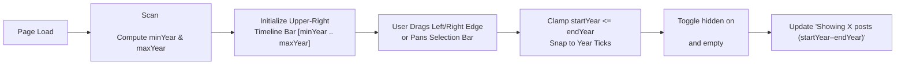

# RFD 0004: Interactive Year-Range Timeline Scrub Bar

- **RFD:** 0004
- **Title:** Interactive Year-Range Timeline Scrub Bar
- **Status:** Proposed
- **Created:** 2026-10-16
- **Related:** [RFD 0001: Progressive Feed Fetching and Year-Sharded Archival](./rfd-0001-progressive-feed-archival.md), [RFD 0002: Hardening Feed Fetching, Parsing and Rendering](./rfd-0002-feed-security-hardening.md), [RFD 0003: Test-Gated Deploys and a Least-Privilege Build Workflow](./rfd-0003-ci-test-gating-and-least-privilege.md)

---

## 1. Summary

This RFD proposes adding a compact, resizable **Timeline Range Bar** anchored in the **upper-right corner of the page header**. The left edge of the bar represents the **earliest post year** (`min_year`) and the right edge represents the **latest post year** (`max_year`). Users can drag either handle (left/start or right/end) or slide the selected window from end to end to dynamically filter which posts and day groups are shown on the page.

---

## 2. Goals & Non-Goals

### Goals
- **Upper-right header placement:** Position the control in the top-right corner of `<header>` alongside the site title and metadata, collapsing gracefully on narrow mobile viewports.
- **Dual-edge resizable window:** Allow dragging the left edge (`startYear`) and right edge (`endYear`) independently between `min_year` and `max_year`, as well as dragging the middle selection bar to pan a fixed-width year window across time.
- **Instant client-side filtering:** Filter visible `<article>` elements and `<div class="day">` date headers in real time without page reloads or external dependencies.
- **On-demand historical loading (RFD 0001 integration):** Seamlessly filter posts already in the DOM, and optionally lazy-fetch older year shards (`feeds/<slug>-<year>.html`) when the user expands the bar into years not pre-rendered on the initial page.
- **Preserve RFD 0002 security guarantees & zero telemetry:** Use pure inline CSS and a small (~60-line) self-contained vanilla JS controller authorized by a deterministic SHA-256 CSP hash (`script-src 'sha256-...'`), with zero external libraries or network analytics.
- **Keyboard & touch accessibility:** Support pointer events (`pointerdown`/`pointermove` for mouse + touch) and arrow-key adjustments on the left/right handles (`role="slider"`).

### Non-Goals
- Sub-day or hour-level scrubbing (granularity is year-based, with automatic fallback when all posts fall within a single calendar year).
- Replacing static HTML readability when JavaScript is disabled (if JS is disabled, the timeline bar stays hidden via `hidden` and all rendered posts remain visible by default).

---

## 3. UI & Visual Design

### 3.1 Header Layout (Upper-Right Placement)

```text
+----------------------------------------------------------------------------------+
| My Feed Reader                                       2021 [===|========|] 2026   |
| Updated Fri Oct 16, 2026 01:00 UTC · Atom feed            Showing: 2023 – 2026   |
|                                                                                  |
| (All) (Maggie Hugo) (Another Blog)                                               |
+----------------------------------------------------------------------------------+
```

- **Header Flex Grid:** `<header>` uses a two-column flex layout (`justify-content: space-between; align-items: flex-start; flex-wrap: wrap`):
  - **Left column (`.hdr-title`):** Site `<h1>`, last-updated timestamp, and Atom link.
  - **Right column (`.tl`):** The timeline bar widget, displaying:
    - Outer bounds labels: `min_year` on the far left, `max_year` on the far right.
    - Track (`.tl-track`): Full span from `min_year` to `max_year` with subtle tick marks for intermediate years.
    - Resizable range selection (`.tl-range`): Highlighted bar (`var(--accent)`) bounded by two draggable edge handles (`.tl-w` on the left, `.tl-e` on the right).
    - Status readout (`.tl-meta`): e.g. `2023 – 2026 · 142 posts` or `All years (2021 – 2026)`.

### 3.2 Edge-Case Behavior: Single-Year Feeds
If `min_year == max_year` (e.g., all posts on the page are from `2026`):
- Both outer labels show `2026`, the bar renders in a full-width selected state (`2026 · N posts`), and handle dragging is locked so the UI never divides by zero.

---

## 4. Technical Architecture



### 4.1 HTML Markup Changes in `build.py`

1. **Annotate each `<article>` with `data-year`:**
   In `render_items()`:
   ```python
   year = str(it["date"].year) if it["date"] else "undated"
   safe_link = html.escape(sanitize_link(it["link"]), quote=True)
   out.append(
       f'<article data-year="{year}">'
       f'<h2><a href="{safe_link}" rel="noopener noreferrer">'
       f'{html.escape(it["title"])}</a></h2>'
       f'<div class="meta">{" · ".join(meta)}</div>{summary}</article>'
   )
   ```
   Also include the four-digit year in `<div class="day">` headers (`it["date"].strftime("%A, %B %d, %Y")`) so posts across multiple years have unambiguous date headings.

2. **Add the Timeline Widget in `<header>` (`page()`):**
   ```html
   <header>
     <div class="hdr-top">
       <div class="hdr-title">
         <h1><a href="index.html">My Feed Reader</a></h1>
         <p>Updated Fri Oct 16, 2026 01:00 UTC · <a href="atom.xml">Atom feed</a></p>
       </div>
       <div class="tl" id="timeline" hidden>
         <div class="tl-row">
           <span class="tl-bound" id="tl-min"></span>
           <div class="tl-track" id="tl-track">
             <div class="tl-range" id="tl-range">
               <button type="button" class="tl-handle tl-w" id="tl-start" role="slider" aria-label="Start year"></button>
               <button type="button" class="tl-handle tl-e" id="tl-end" role="slider" aria-label="End year"></button>
             </div>
           </div>
           <span class="tl-bound" id="tl-max"></span>
         </div>
         <div class="tl-meta" id="tl-meta"></div>
       </div>
     </div>
     <nav>...</nav>
   </header>
   ```
   *(Note: `hidden` is removed by the script on initialization so users with JavaScript disabled never see an inert control.)*

---

### 4.2 CSS Styling (`CSS` in `build.py`)

```css
.hdr-top{display:flex;justify-content:space-between;align-items:flex-start;gap:16px;flex-wrap:wrap}
.tl{min-width:240px;max-width:300px;user-select:none;touch-action:none}
.tl-row{display:flex;align-items:center;gap:8px}
.tl-bound{font-size:.75rem;font-variant-numeric:tabular-nums;color:var(--muted)}
.tl-track{position:relative;flex:1;height:18px;background:var(--card);border:1px solid var(--line);border-radius:999px;cursor:pointer}
.tl-range{position:absolute;top:0;bottom:0;left:0%;right:0%;background:color-mix(in srgb,var(--accent) 22%,transparent);border:1.5px solid var(--accent);border-radius:999px;cursor:grab}
.tl-range:active{cursor:grabbing}
.tl-handle{position:absolute;top:50%;width:12px;height:18px;padding:0;border:2px solid var(--accent);border-radius:999px;background:var(--bg);transform:translate(-50%,-50%);cursor:ew-resize}
.tl-handle.tl-w{left:0}
.tl-handle.tl-e{left:100%}
.tl-handle:focus-visible{outline:2px solid var(--fg);outline-offset:1px}
.tl-meta{margin-top:4px;text-align:right;font-size:.75rem;color:var(--muted);font-variant-numeric:tabular-nums}
```

---

### 4.3 Interaction Mechanics (Resizing & Scrubbing)

The widget supports three gestures using standard Pointer Events (`pointerdown`, `pointermove`, `pointerup` with `setPointerCapture`):

1. **Resize Left Edge (`.tl-w` handle):**
   - Dragging adjusts `startYear` within `[minYear, endYear]`.
   - Left position of `.tl-range` updates to `((startYear - minYear) / span) * 100%`.
2. **Resize Right Edge (`.tl-e` handle):**
   - Dragging adjusts `endYear` within `[startYear, maxYear]`.
   - Right inset of `.tl-range` updates to `((maxYear - endYear) / span) * 100%`.
3. **Slide / Pan Window (`.tl-range` body):**
   - Dragging the middle of the bar shifts both `startYear` and `endYear` together while preserving `endYear - startYear` window width.
4. **Keyboard Accessibility:**
   - Focusing either handle and pressing `ArrowLeft` / `ArrowRight` decrements/increments that edge by 1 year (`Home` / `End` jumps to `minYear` / `maxYear`), updating `aria-valuemin`, `aria-valuemax`, and `aria-valuenow`.

---

### 4.4 Filtering Logic & Day-Header Cleanup

When `(startYear, endYear)` changes:
1. Iterate over all `<article data-year="...">` elements:
   - Parse `y = Number(article.dataset.year)`.
   - For dated posts, set `article.hidden = !(y >= startYear && y <= endYear)`.
   - For undated posts (`data-year="undated"`), keep visible when `endYear === maxYear`.
2. Hide any `<div class="day">` section header whose following `<article>` siblings (up to the next `<div class="day">`) are all `hidden`.
3. Update `#tl-meta` using `textContent` with the active year range and visible post count (e.g., `2023 – 2025 · 48 posts`).

---

## 5. Relationships to Other RFDs

### 5.1 Relationship to RFD 0002 (Security Hardening & CSP)
- **DOM Safety:** The timeline script only reads integer `data-year` attributes, toggles boolean `.hidden` properties, updates CSS percentage offsets (`style.left` / `style.right`), and sets `.textContent` on `#tl-min`, `#tl-max`, and `#tl-meta`. It never touches `innerHTML`, `outerHTML`, `eval`, or untrusted feed text/URLs.
- **Content Security Policy (`script-src` hash):**
  - RFD 0002 §4.6 sets `<meta http-equiv="Content-Security-Policy" content="default-src 'none'; style-src 'unsafe-inline'; base-uri 'none'; form-action 'none'">`.
  - To allow only the built-in timeline script while still blocking `javascript:` links and any injected scripts, `build.py` computes the SHA-256 digest of the constant `TIMELINE_JS` string (`hashlib.sha256(TIMELINE_JS.encode()).digest()`) and emits:
    ```html
    <meta http-equiv="Content-Security-Policy" content="default-src 'none'; style-src 'unsafe-inline'; script-src 'sha256-<base64-hash>'; base-uri 'none'; form-action 'none'">
    ```
  - Note that in CSP Level 2/3, a `'sha256-...'` hash in `script-src` only authorizes the matching `<script>` block and **does not** permit `javascript:` navigation URIs or inline event attributes (`onclick=...`), preserving RFD 0002's defence-in-depth against XSS.

### 5.2 Relationship to RFD 0001 (Progressive Feed Archival)
- When RFD 0001 is active, `build.py` knows the full historical `min_year` and `max_year` for each feed and writes `data-min-year` and `data-max-year` on `#timeline`.
- If a user on `feeds/<slug>.html` drags the left edge of the timeline bar into an older archived year (e.g., `2023`) whose articles are stored in `feeds/<slug>-2023.html`, the timeline controller can optionally fetch same-origin `feeds/<slug>-2023.html` (which requires adding `connect-src 'self'` to the CSP in `page()`), parse it via `DOMParser`, and insert its `<article>` elements into `<main>`.

### 5.3 Relationship to RFD 0003 (CI Test Gating)
- `tests/test_render.py` should be extended with offline unit tests verifying:
  - `<article data-year="...">` emission for dated and undated items;
  - Presence of `#timeline` markup in `page()` output;
  - Exact match between the `<script>` contents and the `'sha256-...'` hash in the `<meta http-equiv="Content-Security-Policy">` tag.

---

## 6. Implementation Plan

1. **Step 1 (`build.py` item markup):** Add `data-year` to `<article>` in `render_items()` and include the four-digit year in `.day` headers (`%A, %B %d, %Y`).
2. **Step 2 (`build.py` header, CSS & CSP):** Add `.hdr-top` and `#timeline` markup/CSS in `page()`, embed `TIMELINE_JS`, and include its `'sha256-...'` hash in the CSP meta tag.
3. **Step 3 (`tests/test_render.py`):** Add unit tests for `data-year`, timeline markup, and CSP script hash verification.
